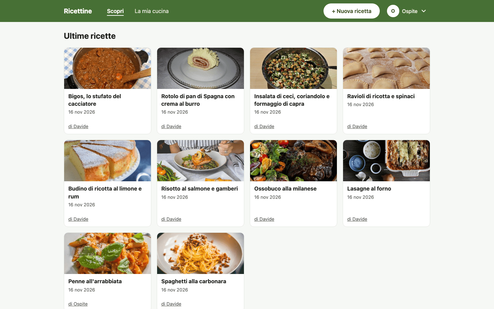
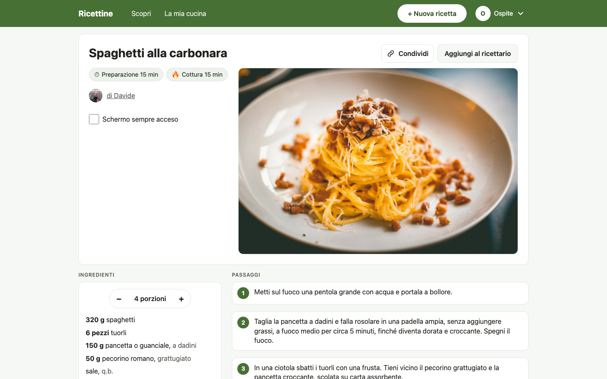
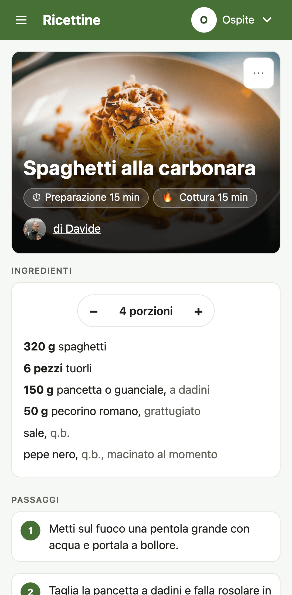

# Ricettine

A self-hosted recipe app for friends and family, built end to end with Claude Code as a portfolio project.

[](https://github.com/Spezialissimo/Ricettine/actions/workflows/ci.yml)
[](https://github.com/Spezialissimo/Ricettine/pkgs/container/ricettine)

[Live site](https://ricettine.food) · [**Try the demo**](https://demo.ricettine.food)

<table>
  <tr>
    <td></td>
    <td></td>
  </tr>
</table>

<table>
  <tr>
    <td></td>
    <td></td>
    <td></td>
  </tr>
</table>

## What this project shows

- **Quality engineering.** Backend integration tests on a real Postgres, Playwright specs in mobile and desktop, and a CI pipeline that runs them on every pull request: [docs/quality.md](docs/quality.md).
- **An isolated public demo.** A second database, wiped at every start and routed by a trusted proxy header, with read-only access: [architecture](docs/architecture.md#site-routing) and [decisions](docs/decisions.md).
- **Infrastructure as code on AWS.** Terraform for one EC2 instance behind CloudFront, plus backup and restore scripts that CI exercises: [docs/deployment.md](docs/deployment.md).
- **AI-assisted workflow.** Specs, plans, code, tests and reviews written by Claude Code, with the owner deciding the product: [docs/ai-workflow.md](docs/ai-workflow.md).
- **Internationalisation.** Italian and English through Transloco, with a unit test that fails when the two files differ: [architecture](docs/architecture.md#frontend).
- **Accessibility basics.** Labels on controls and touch targets of at least 44 px, desktop first and responsive at 768 px: [decisions](docs/decisions.md#4-desktop-first-responsive-at-768-px).
- **Security.** Invite-only registration, sessions in Postgres, rate limits and a read-only, isolated demo: [docs/security.md](docs/security.md).

## Tech stack

- Backend: Spring Boot 4.1 on Java 25, Flyway migrations, PostgreSQL 17.
- Frontend: Angular 22 (standalone components), Transloco, vitest.
- End-to-end tests: Playwright 1.64.
- Packaging: one Docker image (Node 24 build, Eclipse Temurin 25 runtime) and Docker Compose.
- HTTPS and routing: Caddy 2.10.
- Infrastructure: Terraform (>= 1.9, AWS provider 6.x), GitHub Actions.

## Quick start

```sh
docker compose up -d
```

Open <http://localhost:8080> and create the admin account; the admin then invites other people with single-use links. Configuration, HTTPS, upgrades and backups: [docs/deployment.md](docs/deployment.md).

## Documentation

- [Architecture](docs/architecture.md): containers, modules, data model, main flows, frontend.
- [Decisions](docs/decisions.md): the main design decisions in short ADR form.
- [Security](docs/security.md): measures in code and infrastructure.
- [Quality](docs/quality.md): test layers, check scripts and the code audit.
- [Deployment](docs/deployment.md): Docker Compose, HTTPS, upgrades, backups and AWS.
- [AI workflow](docs/ai-workflow.md): how Claude Code was used, what steers it, what went wrong.
- [Roadmap](docs/roadmap.md): what was built, in which order, and what is next.
- [Development](docs/development.md): building, testing, check scripts, screenshots and demo content.
- [docs/superpowers](docs/superpowers): the raw record of specs, plans and audits.

## Credits

Demo recipes and photos come from third-party sources; see [CREDITS.md](CREDITS.md).
