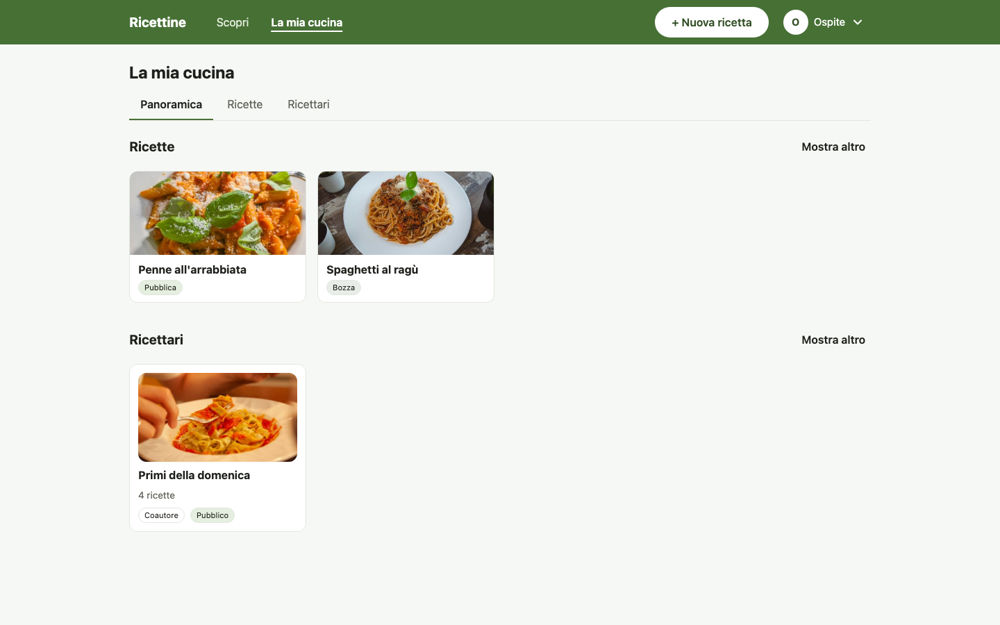
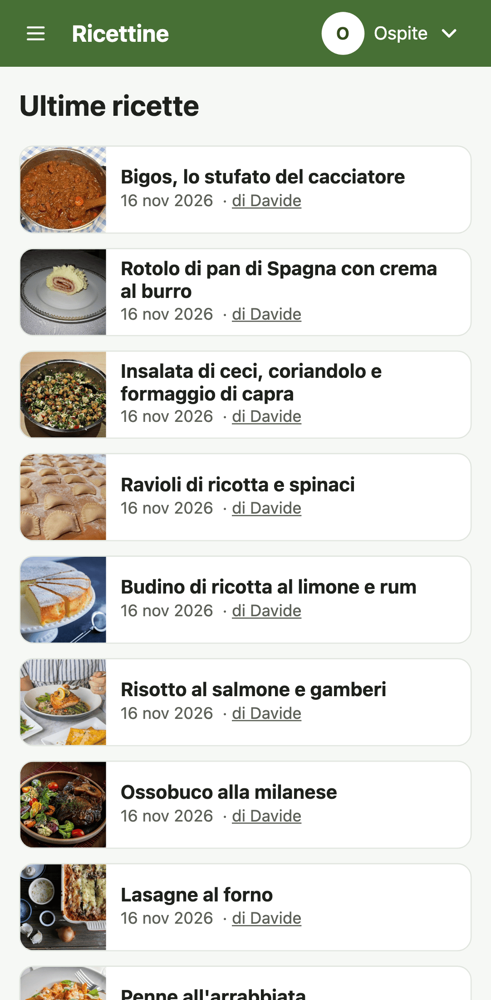
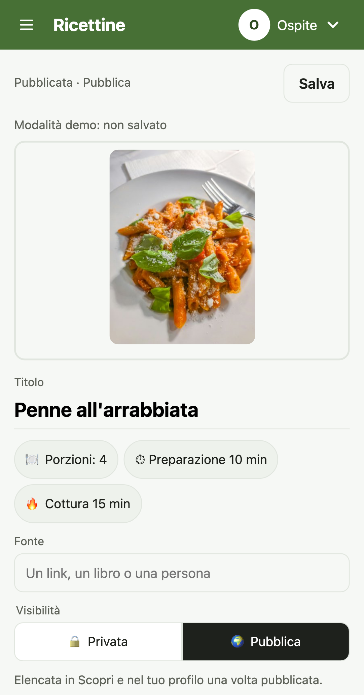

# Ricettine

[](https://github.com/Spezialissimo/Ricettine/actions/workflows/ci.yml)
[](https://github.com/Spezialissimo/Ricettine/pkgs/container/ricettine)

[Live site](https://ricettine.food) · [**Try the demo**](https://demo.ricettine.food)

My girlfriend and I wanted one place to write down our recipes and to collect them in cookbooks, without handing them to a service we do not control. So I started building one: a small recipe app that we host ourselves and that we can open to friends and family by invitation.

Along the way it became something else too. I wanted to learn how far Claude Code can take a project from nothing to something finished, so I used Ricettine as the test. Every feature went through the same loop: a written spec, a plan split into small pull requests, implementation by Claude Code subagents, a review, and CI on every pull request. The same process covered the Docker image, the end-to-end tests, a code audit of the first five plans, and the move to AWS with Terraform. I decided what the product should be and what was good enough; Claude Code wrote most of the code, and I read and corrected a lot of it.

This repository is the result, and the `docs` folder is an honest account of it: what the app does, how it is built, what went wrong and what is still missing. The live site is where we use it. The demo is a read-only copy with sample recipes (Italian, like the rest of the content), so you can look around without an account.

## What it does

**Invite-only accounts.** The first person to open a fresh install creates the admin account. After that nobody can register on their own: the admin creates single-use invite links (valid for 7 days) from the settings, and can also promote other users to admin or generate a password-reset link for someone who is locked out. Each person has a profile with an avatar and can delete their own account.

**Discover.** The home page, "Scopri" in Italian, lists the latest recipes that people have published as public, with a photo, a title and the author. Each author has a public profile page with their public recipes and cookbooks.


**Recipes you can write down quickly.** The editor has a title, a cover photo, the number of portions, preparation and cooking times, a source (a link, a book or a person) and notes. Ingredients have an amount, a unit from a fixed list, a name and an optional note, and can be put into named groups such as "Sauce". Steps can be reordered and each step can have its own photo, uploaded or fetched from a link. The editor saves by itself while you type, and warns you before you leave with something unsaved.


**Drafts, private and public.** A new recipe is a draft that only you can see. When it has a title, an ingredient and a step you can publish it. A published recipe is either public (listed on Discover and on your profile) or private (not listed).

**Reading and cooking.** The recipe page shows the photo, the times, the ingredients and the steps with their photos. A stepper changes the portions and scales the amounts, using kitchen fractions. "Keep screen on" asks the browser not to let the screen sleep while you cook.


**Share links.** Every recipe has a link that anyone can open without an account, and you can reset it to cut off whoever has the old one. Cookbooks have the same.

**Cookbooks and co-authors.** A cookbook has a name, a description, an optional cover photo and a public or private setting. You add your recipes to it, and you can invite co-authors with a single-use link (valid for 7 days); co-authors can add recipes, and the owner can remove a co-author, who can also leave on their own. A cookbook has its own share link and a public page that works without an account.


**My kitchen.** "La mia cucina" gathers your own recipes (drafts included) and your cookbooks, with an overview and a tab for each.



**Italian and English, light and dark.** The interface is available in both languages and in a light and a dark theme; the settings let you follow the device or pick one. The language and theme are saved on the device.

 

**Desktop first, with a phone layout.** The layout is designed for a desktop and adapts at 768 px; on a phone the menus and actions move into a compact layout. Controls are labelled and touch targets are at least 44 px.

  

**A read-only public demo.** The demo site runs on its own database, which is wiped at every start and seeded with sample recipes. Visitors sign in as a guest with one click and can try the editor, but nothing is saved.

## How it is built

- Backend: Spring Boot 4.1 on Java 25, Flyway migrations, PostgreSQL 17.
- Frontend: Angular 22 (standalone components), Transloco, vitest.
- End-to-end tests: Playwright 1.64.
- Packaging: one Docker image (Node 24 build, Eclipse Temurin 25 runtime) and Docker Compose.
- HTTPS and routing: Caddy 2.10.
- Infrastructure: Terraform (>= 1.9, AWS provider 6.x), GitHub Actions.

## Quick start

```sh
docker compose up -d
```

Open <http://localhost:8080> and create the admin account; the admin then invites other people with single-use links. Configuration, HTTPS, upgrades and backups: [docs/deployment.md](docs/deployment.md).


## A guide to the docs

**Using the app and running it**

- Check [docs/deployment.md](docs/deployment.md) if you want to run Ricettine yourself: Docker Compose, HTTPS, upgrades, backups and restores, and the AWS setup with Terraform.
- Check [docs/development.md](docs/development.md) if you want to build and test it locally: the commands, the check scripts, how the screenshots and the demo content are produced.

**How it is built**

- Check [docs/architecture.md](docs/architecture.md) if you are interested in how the pieces fit together: containers, backend modules, data model, main flows and the frontend.
- Check [docs/decisions.md](docs/decisions.md) if you are interested in why it is that way: the main design decisions in short ADR form.
- Check [docs/security.md](docs/security.md) if you are interested in what protects it: the measures in code and in the infrastructure.
- Check [docs/quality.md](docs/quality.md) if you are interested in how it is tested: test layers, check scripts, CI and the code audit.
- Check [CREDITS.md](CREDITS.md) if you want to know where the demo recipes and photos come from.

**How it was built with Claude Code**

- Check [docs/ai-workflow.md](docs/ai-workflow.md) if you are interested in the process: how Claude Code was used, what steers it, and what went wrong.
- Check [docs/roadmap.md](docs/roadmap.md) if you are interested in the order of work: the nine plans with their dates, and what is next.
- Check [CLAUDE.md](CLAUDE.md) if you want to see the project instructions that Claude Code reads at the start of every session.
- Check [docs/superpowers](docs/superpowers) if you want the raw record: the specs, plans, audits and follow-ups of every plan.

## Credits

Demo recipes and photos come from third-party sources; see [CREDITS.md](CREDITS.md).
