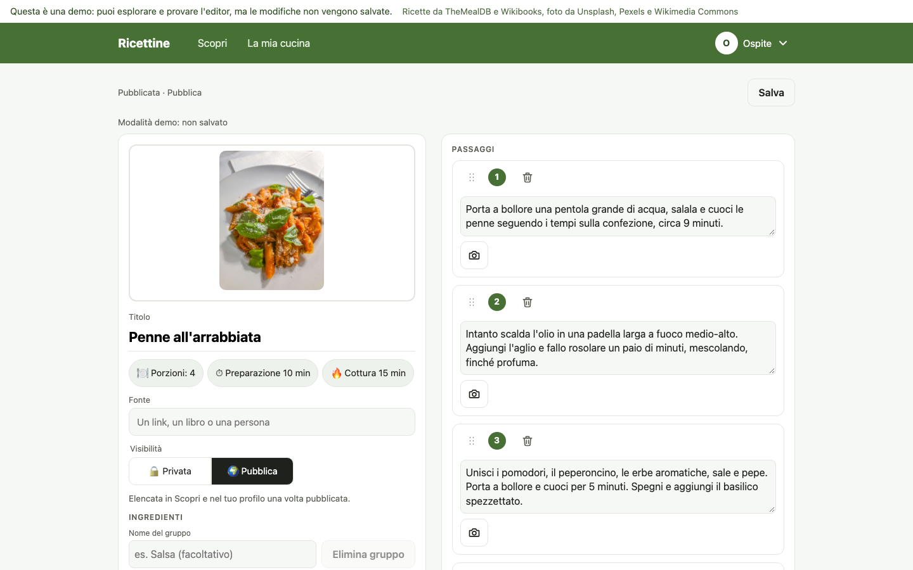
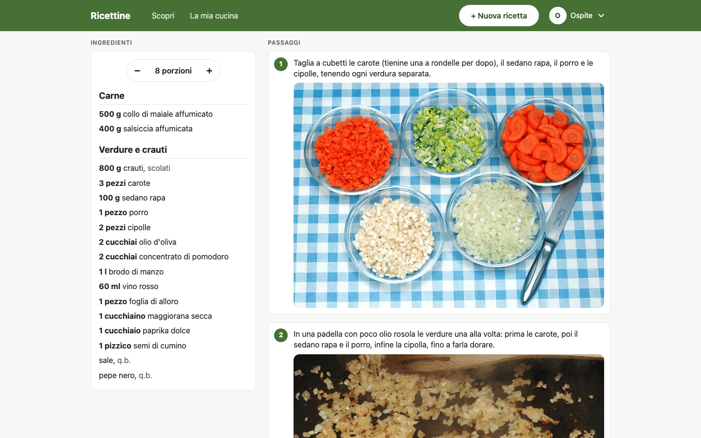
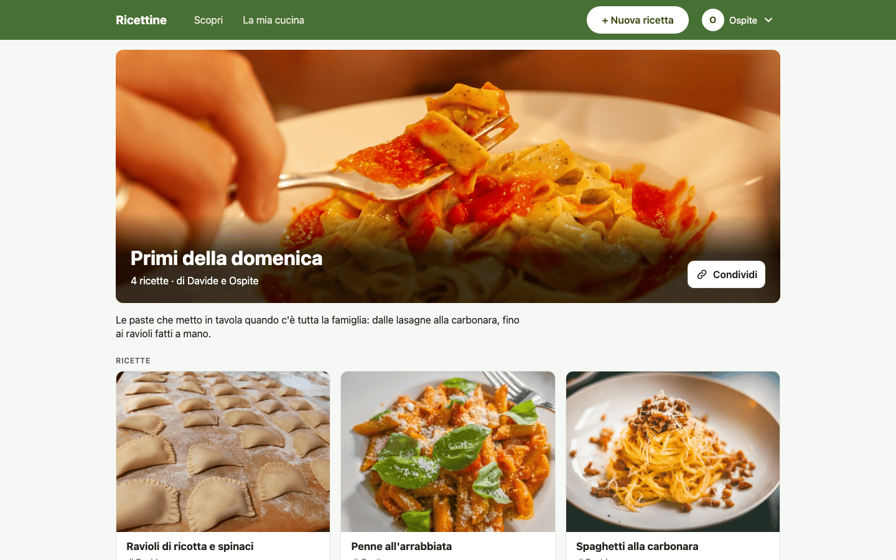
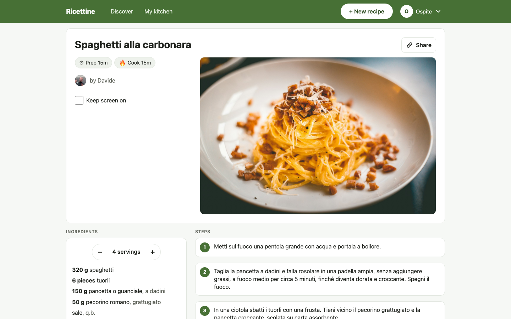
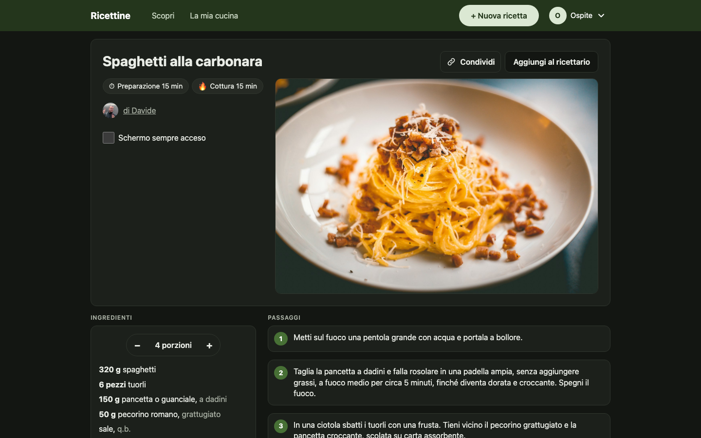

<div align="center">

# Ricettine

[](https://github.com/Spezialissimo/Ricettine/actions/workflows/ci.yml)
[](https://github.com/Spezialissimo/Ricettine/pkgs/container/ricettine)

[Live site](https://ricettine.food) · [**Try the demo**](https://demo.ricettine.food)

</div>

Ricettine is a small recipe website: you write your recipes, share them by link or publicly, and collect them in cookbooks that other people can help you fill.

The original idea comes from the simple need for my girlfriend and me to have a space where we could share and manage our recipes. I decided to take the chance to learn how a project can go from zero to a working service using Claude Code.

The docs in this repo are quite comprehensive: check the index below if you are wondering what the stack is, how development with Claude Code was set up and how it went, and much more.

## Contents

- [Requirements](#requirements)
- [What it does](#what-it-does)
- [How it is built](#how-it-is-built)
- [Quick start](#quick-start)
- [A guide to the docs](#a-guide-to-the-docs)
- [Credits](#credits)

## Requirements

These are the functional requirements we set at the start, in the [original design](docs/superpowers/specs/2026-11-03-ricettine-design.md), and they still shape every change.

- **Self-hostable from the ground up.** One `docker compose up` with the published image and Postgres gives a working instance with no required configuration: sensible defaults, images on a local volume, a first-run screen that creates the admin, and no default passwords. Everything else is an environment variable. Upgrading means pulling the new image and restarting; database migrations run by themselves. The image is built for amd64 and arm64, images can live on local disk or any S3-compatible store, and HTTPS is a documented Caddy overlay.
- **The same artifact, also hosted.** The public instance runs the same image and the same Compose setup on a single small AWS instance, with no cloud-specific code in the app apart from the optional S3 storage.
- **Quick to use while cooking.** Writing a recipe on a phone with messy hands has to be easy enough that it actually happens: large touch targets, an editor that saves by itself, and nothing lost if the phone locks or the connection drops.
- **Private things stay private.** Private recipes and cookbooks never appear in listings, drafts are visible only to their author, share links are not guessable, photo metadata (including location) is stripped on upload, and deleting an account deletes its data and files.
- **Made for a small group.** Several accounts from day one, invite-only, with no email server needed: the admin hands out invite and password-reset links.
- **Sharing and cookbooks together.** Any published recipe or cookbook can be shared by link, and two accounts can build a cookbook together.
- **Ready for more than one language.** Every interface string goes through translation files; the app ships in Italian and English.
- **Cheap to run.** Hosting for two people must not cost real money, and self-hosting must not need more than one command.

## What it does

**Invite-only accounts.** The first person to open a fresh install creates the admin account. After that nobody can register on their own: the admin creates single-use invite links (valid for 7 days) from the settings, and can also promote other users to admin or generate a password-reset link for someone who is locked out. Each person has a profile with an avatar and can delete their own account.

**Discover.** The home page, "Scopri" in Italian, lists the latest recipes that people have published as public, with a photo, a title and the author. Each author has a public profile page with their public recipes and cookbooks.


**Recipes you can write down quickly.** The editor has a title, a cover photo, the number of portions, preparation and cooking times, a source (a link, a book or a person) and notes. Ingredients have an amount, a unit from a fixed list, a name and an optional note, and can be put into named groups such as "Sauce". Steps can be reordered and each step can have its own photo, uploaded or fetched from a link. The editor saves by itself while you type, and warns you before you leave with something unsaved.



**Drafts, private and public.** A new recipe is a draft that only you can see. When it has a title, an ingredient and a step you can publish it. A published recipe is either public (listed on Discover and on your profile) or private (not listed).

**Reading and cooking.** The recipe page shows the photo, the times, the ingredients and the steps with their photos. A stepper changes the portions and scales the amounts, using kitchen fractions. "Keep screen on" asks the browser not to let the screen sleep while you cook.



**Share links.** Every recipe has a link that anyone can open without an account, and you can reset it to cut off whoever has the old one. Cookbooks have the same.

**Cookbooks and co-authors.** A cookbook has a name, a description, an optional cover photo and a public or private setting. You add your recipes to it, and you can invite co-authors with a single-use link (valid for 7 days); co-authors can add recipes, and the owner can remove a co-author, who can also leave on their own. A cookbook has its own share link and a public page that works without an account.



**My kitchen.** "La mia cucina" gathers your own recipes (drafts included) and your cookbooks, with an overview and a tab for each.


**Italian and English, light and dark.** The interface is available in both languages and in a light and a dark theme; the settings let you follow the device or pick one. The language and theme are saved on the device.

 

**Desktop first, with a phone layout.** The layout is designed for a desktop and adapts at 768 px; on a phone the menus and actions move into a compact layout. Controls are labelled and touch targets are at least 44 px.

  

**A read-only public demo.** The demo site runs on its own database, which is wiped at every start and seeded with sample recipes. Visitors sign in as a guest with one click and can try the editor, but nothing is saved.

## How it is built

- Backend: Spring Boot 4.1 on Java 25, Flyway migrations, PostgreSQL 17.
- Frontend: Angular 22 (standalone components), Transloco, vitest.
- End-to-end tests: Playwright 1.64.
- Packaging: one Docker image (Node 24 build, Eclipse Temurin 25 runtime) and Docker Compose.
- HTTPS and routing: Caddy 2.10.
- Infrastructure: Terraform (>= 1.9, AWS provider 6.x), GitHub Actions.

## Quick start

```sh
docker compose up -d
```

Open <http://localhost:8080> and create the admin account; the admin then invites other people with single-use links. Configuration, HTTPS, upgrades and backups: [docs/deployment.md](docs/deployment.md).

## A guide to the docs

**Using the app and running it**

- Check [docs/deployment.md](docs/deployment.md) if you want to run Ricettine yourself: Docker Compose, HTTPS, upgrades, backups and restores, and the AWS setup with Terraform.
- Check [docs/development.md](docs/development.md) if you want to build and test it locally: the commands, the check scripts, how the screenshots and the demo content are produced.

**How it is built**

- Check [docs/architecture.md](docs/architecture.md) if you are interested in how the pieces fit together: containers, backend modules, data model, main flows and the frontend.
- Check [docs/decisions.md](docs/decisions.md) if you are interested in why it is that way: the main design decisions in short ADR form.
- Check [docs/security.md](docs/security.md) if you are interested in what protects it: the measures in code and in the infrastructure.
- Check [docs/quality.md](docs/quality.md) if you are interested in how it is tested: test layers, check scripts, CI and the code audit.
- Check [CREDITS.md](CREDITS.md) if you want to know where the demo recipes and photos come from.

**How it was built with Claude Code**

- Check [docs/ai-workflow.md](docs/ai-workflow.md) if you are interested in the process: how Claude Code was used, what steers it, and what went wrong.
- Check [docs/roadmap.md](docs/roadmap.md) if you are interested in the order of work: the nine plans with their dates, and what is next.
- Check [CLAUDE.md](CLAUDE.md) if you want to see the project instructions that Claude Code reads at the start of every session.
- Check [docs/superpowers](docs/superpowers) if you want the raw record: the specs, plans, audits and follow-ups of every plan.

## Credits

Demo recipes and photos come from third-party sources; see [CREDITS.md](CREDITS.md).
