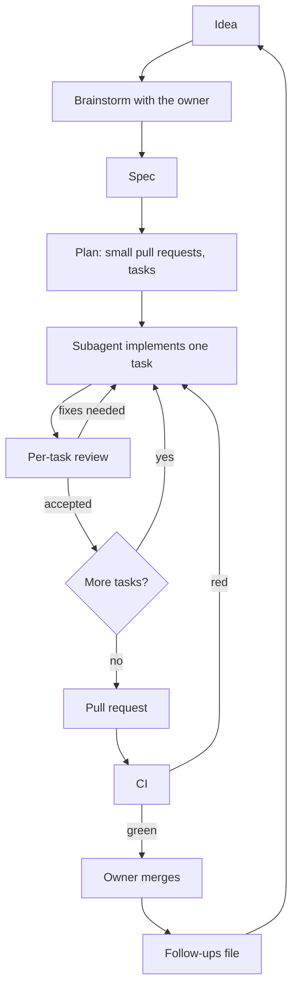

# AI workflow

Ricettine was built end to end with Claude Code. The owner decides what the product is; Claude writes the specs, plans, code, tests and docs, and reviews its own work in separate steps. This page describes the loop, the files that steer it, what went wrong, and where the raw record is.

## The numbers

Counted on 2026-11-16, before this documentation commit:

- 266 commits (`git rev-list --count HEAD`), the first on 2026-11-03 and the latest on 2026-11-16.
- 51 merged pull requests (`gh pr list --state merged`), of which 9 are Dependabot bumps of GitHub Actions.
- 9 plans (`docs/superpowers/plans`), counting `plan-6-code-audit` and `plan-6-audit-fixes` as one plan, plus six follow-up files.
- 3 specs (`docs/superpowers/specs`) and one audit report (`docs/superpowers/audits`).

The whole project took 14 calendar days from first commit to this page.

## The loop

1. **Brainstorm.** Claude asks the owner questions one at a time until scope, constraints and anti-goals are clear. Decisions that the owner makes here go into the spec, including what was ruled out.
2. **Spec and plan.** The spec says what and why. The plan splits the work into small pull requests, each a feature slice, and each pull request into tasks with exact files, tests and commands.
3. **Implementation.** Each task is given to a fresh subagent with only the context it needs. It writes the test first where it can, makes it pass, and commits.
4. **Review.** Every task is reviewed once by another agent that reads the diff, not the implementer's summary. Findings are fixed before the next task.
5. **Pull request and CI.** Each pull request carries backend integration tests and Playwright specs that pass in both the `mobile` and `desktop` projects. CI (backend, frontend, e2e, smoke, smoke-arm64, infra) has to be green.
6. **Follow-ups.** What reviewers noticed but the pull request deliberately did not do is written to a `*-followups.md` file. The next plan starts by reading it.

## What steers Claude

**`CLAUDE.md`** is committed to the repository and is loaded at the start of every session. It holds what a newcomer needs and what Claude would otherwise get wrong: layout, commands, CI, conventions. For example:

> Small PRs, one feature slice each. Every PR has backend integration tests plus Playwright specs that pass in both `mobile` and `desktop`. Automate checks instead of listing manual steps.

> APIs are client-agnostic JSON. Ids are assigned by the server, never by the client.

> Before starting a new plan, read `docs/superpowers/plans/2026-11-03-plan-1-followups.md`.

**Memory** is a set of short notes that Claude keeps between sessions: the owner's preferences (how heavy a process they want, what to leave for later) and the state of the project (which plans are merged, what comes next). It lives outside the repository and is not part of it, so it is not published here. Anything that a reader of the code needs must be in the repository, which is why `CLAUDE.md` and the docs exist.

**Skills** are packaged instructions for a kind of task. The loop above is made of them: one for brainstorming before any creative work, one for turning a spec into a plan, one for executing a plan with a subagent per task and a review per task, and others for test-first development, systematic debugging and verifying before claiming a result. They keep the process the same from one session to the next.

## Roles

**Owner:**
- Product decisions: what the app is for, what is in and out of a plan.
- Rulings when options conflict, for example which audit findings to fix and which to defer (recorded in the audit report on 2026-11-08), or which content may be published.
- Review of what is visible: the UI, and the content of the demo.
- Access that an agent should not have: the AWS account, domain and registry.
- Merging.

**Claude:**
- Questions during brainstorming, specs, plans.
- Code, tests, scripts, infrastructure as code and documentation.
- Running the checks and reporting what they actually returned.
- Reviewing, and writing up follow-ups.

## What went wrong

- **The process cost grew.** Early plans used several reviews per task and let fix rounds widen to cover new findings. That was slow and expensive for small changes, so the owner asked for a leaner process: one review per task, a stronger model only for sensitive pull requests, no widened fix rounds, quiet test output. Plan 9's plan states it (`docs/superpowers/plans/2026-11-15-plan-9-demo-and-docs.md`).
- **CI was unavailable for a while.** Around 2026-11-04 workflow runs failed to start (`startup_failure` in the run history), and the Plan 5 plan, written on 2026-11-05, says "CI does not run (the Actions account is locked)". Local scripts (`./mvnw verify`, `ng test`, `scripts/e2e.sh` and the pull request's own check) became the gate, and each pull request description said so. The run history shows successful pull request runs again by 2026-11-06, and CI is the gate since.
- **The audit found issues in AI-written code.** The Plan 6 audit of the first five plans reported 102 findings: 2 High, 28 Medium, 72 Low, none Critical, across backend security, backend domain, backend tests, frontend app, frontend tests and e2e, and ops. The Highs were per-IP rate limits that a spoofed `X-Forwarded-For` header bypassed, and a smoke script that could wipe a self-hosted stack. Mediums included `1,000` silently saving as 1, a heap sized to 75% of host RAM, and mutable CI action tags. The owner chose to fix all High and Medium findings plus 21 cheap Low ones. Duplication was mostly in tests. See [quality.md](quality.md#plan-6-code-audit).
- **Approaches were retracted in brainstorming.** For the demo content, GialloZafferano recipes were rejected because the owner has no right to publish them. TheMealDB photos were dropped because their licence was unclear, and a stock photo was dropped because its licence was unknown. The demo uses TheMealDB text, adapted and translated, with photos from Unsplash, Pexels and Wikimedia Commons; see [CREDITS.md](../CREDITS.md) and the Plan 9 spec.
- **A blank SPA that unit tests missed.** The async app initializer called `inject()` after an `await`, which left the app blank on every site. Only the browser e2e run showed it. A unit test now guards the pattern (PR #50).
- **The demo container ran out of memory.** With the demo enabled, the 1 GiB container was OOM-killed under e2e load. The JVM budget was lowered (`-XX:MaxRAMPercentage=60`, `MALLOC_ARENA_MAX=2`) and `e2e.sh` and `smoke.sh` now fail if the container restarts or is OOM-killed (PR #50).
- **The gate for that could hang.** The new memory check called `docker events --until` with a time from the host clock, which diverged from the Docker VM's after the Mac slept, so it waited forever. Its window now comes from the daemon's clock and the call is capped at 15 seconds (PR #50).
- **A merge broke `main`.** PR #48 added `demo` and `demoUrl` to `GET /api/setup/status`, but `smoke.sh` matched the old body exactly. #48 merged with `smoke` and `smoke-arm64` red, and #49 updated the check. A green CI is the gate for that reason.
- **Production depended on a test-only bean.** In review of Plan 9's first pull request, the main data source was found to require a `JdbcConnectionDetails` bean that only tests and Docker Compose service connections provide. The fix (commit `0a21868`) falls back to `spring.datasource.*`, and `PlainDataSourcePropertiesIT` starts the app that way.

## The raw record

- [Specs](superpowers/specs): the design for the app, the audit and the demo.
- [Plans](superpowers/plans): the task-level plans and the follow-up files.
- [Audits](superpowers/audits): the Plan 6 report with a decision on each finding.
- [Roadmap](roadmap.md): what each plan delivered, and what is next.
