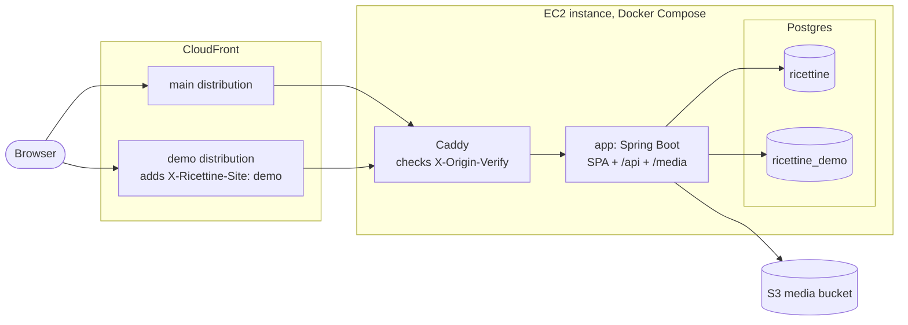
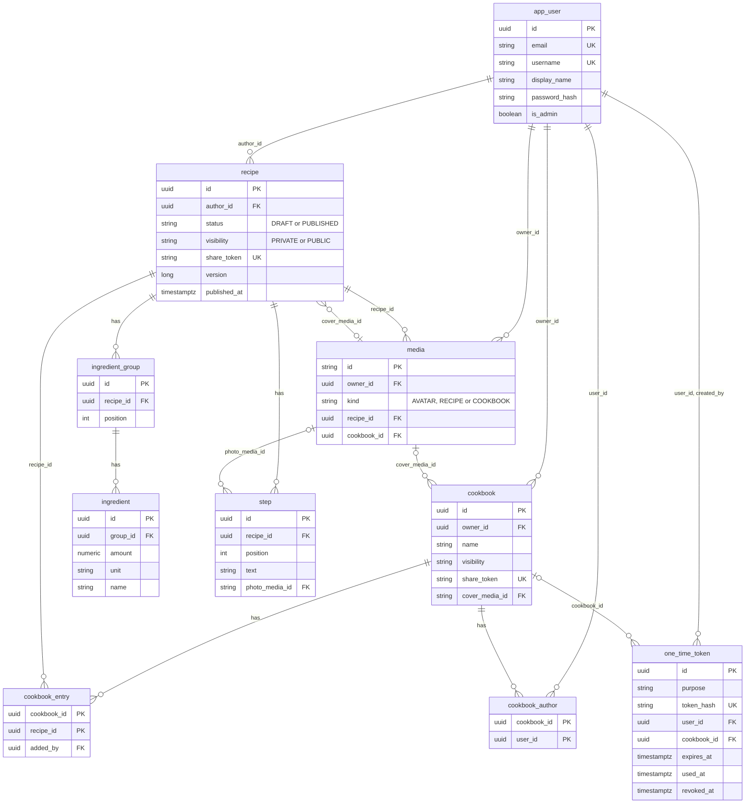
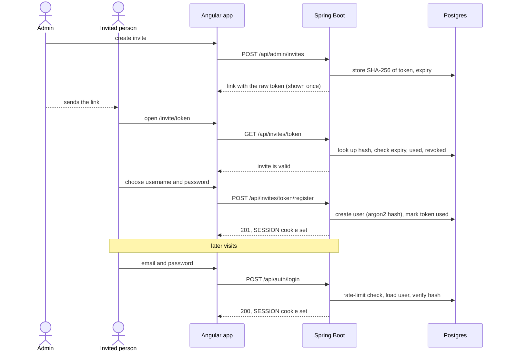
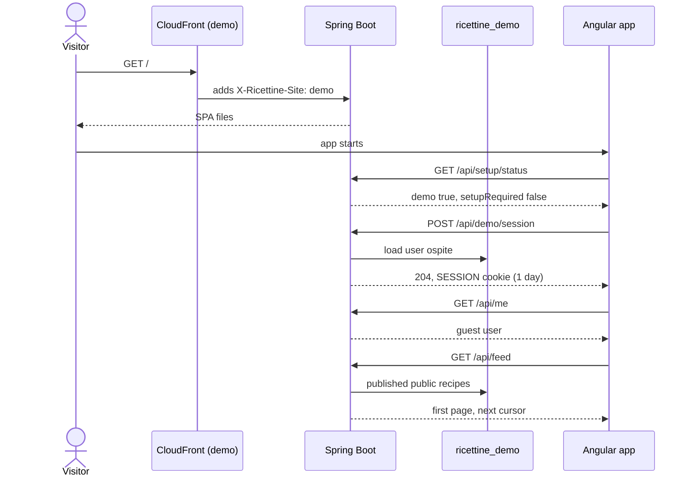

# Architecture

Ricettine is one Spring Boot application that serves the Angular single-page app and a JSON API under `/api`. It runs next to a Postgres container, built as one Docker image and started with Compose. This page describes what is in the repository today.

## Containers

On AWS the stack is one EC2 instance running three containers (Caddy, the app, Postgres), behind CloudFront. Self-hosters run the same image with `compose.yaml`, optionally with their own Caddy (`compose.https.yaml`).

- `/media/*` has its own CloudFront cache behaviour (it honours the origin's `Cache-Control`, at most one day); all other paths are not cached (`infra/terraform/edge.tf`).
- The demo database exists only when `RICETTINE_DEMO_ENABLED=true`. It is dropped, recreated and migrated at every start.
- Without S3 settings the app stores images on a local volume (`RICETTINE_STORAGE_TYPE=local`).
- Database dumps go from the host to a separate S3 bucket (`deploy/backup.sh`, a systemd timer).

## Site routing

Both sites run in the same JVM. Every request gets a site, `MAIN` or `DEMO`, from the `X-Ricettine-Site` header (`SiteFilter`). It is `DEMO` only when the demo is enabled and the header says `demo`. The application `DataSource` is a router (`SiteRoutingDataSource`) over two Hikari pools, one per database, and picks the pool from the current site. Blob keys of the demo live under the `demo/` prefix. The header is trusted, so only the edge sets it: the demo CloudFront distribution adds it, the main one never forwards it from viewers, and the self-host Caddyfile overwrites it. See [decisions](decisions.md#7-demo-isolation-by-routed-database) and [security](security.md#demo-isolation-and-read-only-behaviour).

## Backend modules

Package `com.ricettine.<feature>` under `backend/src/main/java`. Each feature owns its controllers, services, entities and repositories.

| Package | Responsibility |
| --- | --- |
| `account` | Users, `/api/me`, avatars, account deletion hooks |
| `admin` | Admin-only user management |
| `auth` | Login, sessions, password reset |
| `common` | Errors (problem+json), one-time tokens, rate limits, ids |
| `config` | Security chain, headers, password encoder, SPA serving |
| `cookbook` | Cookbooks, co-authors, entries, cookbook invites, public cookbook links |
| `feed` | Cursor-paged feed of public recipes |
| `invite` | Admin-created invites and registration |
| `media` | Image processing, blob stores (local, S3), per-kind access policies |
| `profile` | User profile pages |
| `recipe` | Recipes, ingredients, steps, photos, share links, orphan photo cleanup |
| `setup` | First-run admin setup and `/api/setup/status` |
| `site` | Site routing, demo database, demo seeder, read-only filter, guest sign-in |

Database migrations are Flyway files in `backend/src/main/resources/db/migration` (`V1` to `V9`).

## Data model

Core tables, from migrations `V1` to `V9`. Ids are UUIDs assigned by the server; `media.id` is a random string. Spring Session keeps its own tables (`spring_session*`) and is left out.

Notes:

- Tokens (invites, password resets, cookbook invites) are stored only as SHA-256 hashes in `one_time_token`.
- A recipe's `version` is used for optimistic locking: a save or publish with a stale version is refused with 409.
- Deleting a media row sets the referencing columns to null (`ON DELETE SET NULL`); `V5` and `V7` index those columns so that delete does not scan whole tables.
- `V9` adds a partial index for the feed: published, public recipes ordered by `published_at, id`.

## Flow: invite, register, login

The first visitor of a fresh install creates the admin through `/api/setup/admin`. Everyone else needs an invite.

## Flow: demo first visit

On the demo site nobody has to sign in. The app asks which site it is, signs in the guest account `ospite` when it is the demo, and shows the feed.

If a later request gets a 401 (sessions are lost when the demo database is recreated), the SPA starts the guest session again and retries once (`auth.interceptor.ts`). Every other write is refused with 403 `demo_read_only`.

## Frontend

`frontend/` is a standalone-component Angular app (no NgModules), built with `ng build` into the static files the backend serves.

- `src/app/core`: auth store, route guards, HTTP interceptor (XSRF header, session expiry), site and setup status, theme, language.
- Feature folders: `auth`, `feed`, `recipes` (editor, viewer), `cookbooks`, `kitchen` (the author's own recipes), `profile`, `settings`, `admin`, plus `shell` (top bar, account menu, demo banner) and `shared`.
- Routes live in `app.routes.ts`; the heavy pages are lazy-loaded. Public pages (`/r/:token`, `/c/:token`) sit outside the signed-in shell.
- Unit tests are vitest specs next to the code. Browser tests are Playwright specs in `e2e/tests`, run in a `mobile` and a `desktop` project against the built image.

### Internationalisation

All UI text goes through Transloco keys, with files in `frontend/public/i18n` for English (`en.json`) and Italian (`it.json`). A unit test (`i18n-parity.spec.ts`) fails when the two files do not have the same keys. The choice (System, English or Italian) is kept per browser; System follows the browser language and falls back to English.
