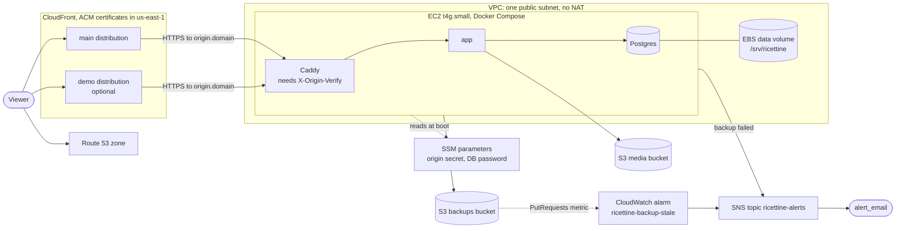

# Deployment

How to run Ricettine yourself: with Docker Compose on any host, or on AWS with the Terraform in `infra/terraform/`. For the design behind the stack see [architecture.md](architecture.md); for the threat model see [security.md](security.md).

- [Self-hosting with Docker Compose](#self-hosting-with-docker-compose): configuration, HTTPS, upgrading, backups.
- [Hosting on AWS](#hosting-on-aws): topology, cost, first deploy, upgrade, restore, rotate the origin secret, demo site, teardown.

## Self-hosting with Docker Compose

`docker compose up -d` starts the published image and Postgres (see the Quick start in the [README](../README.md)). Data lives in two named volumes: `db-data` (Postgres) and `app-data` (uploaded images, mounted at `/data`). `compose.yaml` is image-only; the overlays `compose.build.yaml` (build locally), `compose.https.yaml` (Caddy with Let's Encrypt) and `compose.aws.yaml` (the AWS host) are added with `-f`.

### Configuration

Everything is optional. Set variables in a `.env` file next to `compose.yaml` or in the `app` service's `environment`.

| Variable | Default | Description |
| --- | --- | --- |
| `RICETTINE_BASE_URL` | derived from the request | Public URL of the app, e.g. `https://recipes.example.com`. **Set this in production**: otherwise invite and password-reset links are built from the request `Host` header. |
| `RICETTINE_VERSION` | `latest` | Image tag to run, e.g. `1.2.0`. See [Upgrading](#upgrading). |
| `RICETTINE_MEM_LIMIT` | `1g` | Memory limit of the `app` container. The JVM heap is 60% of it (the rest covers metaspace, code cache and image decoding), so raise it for a large library rather than removing it (not used by `compose.aws.yaml`, which pins `1g`). |
| `RICETTINE_TRUSTED_PROXIES` | matches nothing (Caddy overlays: loopback and private ranges) | Regex of peer addresses whose `X-Forwarded-For` the app believes, for the per-IP rate limits. With `:8080` published directly there is no proxy, so none is trusted; the Caddy overlays trust their Docker network. Set it only for your own reverse proxy. |
| `RICETTINE_DEMO_ENABLED` | `false` | Serve a public demo site next to the real one, in its own database (`ricettine_demo`, wiped and recreated at every start). A request is the demo only if your reverse proxy sets `X-Ricettine-Site: demo` (case-insensitive); the app trusts that header, so only a proxy you control may set it, and it must overwrite any client-sent value. With `compose.https.yaml`, `RICETTINE_DEMO_DOMAIN` does this for you. |
| `RICETTINE_DEMO_URL` | - | Public URL of the demo site, e.g. `https://demo.example.com`. Optional; the app reports it in `/api/setup/status`. |
| `RICETTINE_DEMO_DOMAIN` | - | `compose.https.yaml` only: a second host name that Caddy serves as the demo site (and gets a certificate for). Also set `RICETTINE_DEMO_ENABLED=true` and `RICETTINE_DEMO_URL`. Point its DNS at the same server. |
| `POSTGRES_PASSWORD` | `ricettine` | Database password (used by both `db` and `app` in `compose.yaml`). Postgres is not published to the host. **Only applied when the `db-data` volume is first created**: changing it later does not change the existing database's password (change it inside Postgres with `ALTER USER ricettine PASSWORD '...'` and then update the variable). |
| `SPRING_DATASOURCE_URL` | `jdbc:postgresql://db:5432/ricettine` | JDBC URL, if you use your own Postgres. |
| `SPRING_DATASOURCE_USERNAME` / `SPRING_DATASOURCE_PASSWORD` | `ricettine` | Database credentials. |
| `RICETTINE_STORAGE_TYPE` | `local` | Image storage: `local` or `s3`. |
| `RICETTINE_STORAGE_LOCAL_PATH` | `/data/media` | Directory for `local` storage (inside the `app-data` volume). |
| `RICETTINE_STORAGE_S3_BUCKET` | - | Bucket name (required when type is `s3`). |
| `RICETTINE_STORAGE_S3_REGION` | SDK default | S3 region. |
| `RICETTINE_STORAGE_S3_ENDPOINT` | AWS | Custom endpoint for S3-compatible stores (MinIO, R2, ...). |
| `RICETTINE_STORAGE_S3_PATH_STYLE` | `false` | Use path-style addressing (needed by most S3-compatible stores). |
| `RICETTINE_STORAGE_S3_API_CALL_TIMEOUT` | `PT30S` | Overall time limit for one S3 call, retries included (ISO-8601 duration). |
| `RICETTINE_STORAGE_S3_API_CALL_ATTEMPT_TIMEOUT` | `PT10S` | Time limit for a single S3 attempt. |
| `RICETTINE_STORAGE_S3_CONNECTION_TIMEOUT` | `PT5S` | Time limit for opening the connection to S3. |
| `RICETTINE_SECURITY_MAX_CONCURRENT_HASHES` | `4` | Password hashes (login, sign-up, password change) computed at once; each needs ~16 MB. Extra requests wait up to 10 s, then get "busy, try again". |
| `JAVA_TOOL_OPTIONS` | `-XX:MaxRAMPercentage=60` | JVM options. The default sizes the heap to 60% of the container memory limit. Metaspace and the code cache are left uncapped on purpose (see the comment in the `Dockerfile`); the image also sets `MALLOC_ARENA_MAX=2` to bound native memory. |

### HTTPS

To serve the app on your own domain with a certificate from Let's Encrypt:

1. Point a DNS A record for the domain at the server and open ports 80 and 443 (443/udp for HTTP/3).
2. Run one command:

```sh
RICETTINE_DOMAIN=recipes.example.com docker compose -f compose.yaml -f compose.https.yaml up -d
```

(or put `RICETTINE_DOMAIN` in `.env`). Caddy terminates TLS, redirects HTTP to HTTPS, sets HSTS, and the app is no longer published on `:8080`; invite and reset links use `https://<domain>`.

Caddy has **no access logs on purpose**: invite, password-reset and share tokens are part of URL paths, so request logs would leak them. Its error log (for example a 502 while the app restarts) has request URIs and headers removed for the same reason.

If you run your own reverse proxy instead, make it set `X-Forwarded-For` (the real client address, overwriting any client-sent value; it feeds the rate limits) and `X-Forwarded-Proto`, set `RICETTINE_BASE_URL`, set `RICETTINE_TRUSTED_PROXIES` to a regex matching your proxy's address as the app sees it (otherwise `X-Forwarded-For` and `X-Forwarded-Proto` are ignored: every client shares the proxy's rate limit, the `SESSION` and `XSRF-TOKEN` cookies lose `Secure`, and links are `http://` unless `RICETTINE_BASE_URL` is set), and disable access logs for the same reason.

### Upgrading

Images are published by CI to `ghcr.io/spezialissimo/ricettine` on every push to `main` (`latest`, `sha-...`) and on `v*` tags (semver), for amd64 and arm64. To upgrade:

```sh
docker compose pull && docker compose up -d
```

Database migrations run automatically on startup. Your data stays in the `db-data` and `app-data` volumes. To pin a version, set `RICETTINE_VERSION=x.y.z` in `.env` (default `latest`).

If you run your own reverse proxy, set `RICETTINE_TRUSTED_PROXIES` before upgrading: the app now trusts no proxy by default, so without it forwarded headers are ignored (see the `RICETTINE_TRUSTED_PROXIES` row under Configuration).

#### Building from source

```sh
docker compose -f compose.yaml -f compose.build.yaml up -d --build
```

### Backups

The scripts live in `deploy/`. Run them from the repo root (`deploy/backup.sh`), or copy them next to `compose.yaml` and run them there; they use the compose files and `.env` in the current directory and honour `COMPOSE_FILE`.

`deploy/backup.sh` writes a timestamped database dump (`ricettine-<UTC>.dump`) and, with local storage, a media archive (`ricettine-<UTC>-media.tar.gz`) into `BACKUP_DIR` (default `./backups`). A failed local run leaves no files behind; in S3 mode a failed run may leave a dump without its media partner, so use the newest complete pair. `RICETTINE_STORAGE_TYPE`, `BACKUP_S3_URI` and `BACKUP_DIR` are read from the environment or, if unset there, from `.env`. Set `BACKUP_S3_URI=s3://bucket/prefix/` to upload with the `aws` CLI instead. With `RICETTINE_STORAGE_TYPE=s3` the media archive is skipped.

```sh
# nightly at 03:15
15 3 * * * cd /opt/ricettine && deploy/backup.sh >>backup.log 2>&1
```

To restore, replacing the current data: `deploy/restore.sh backups/ricettine-<UTC>.dump [backups/ricettine-<UTC>-media.tar.gz]`. The database restore is one transaction: if it fails, the database is unchanged and the app stays stopped (`docker compose up -d app` starts it again). The media directory is replaced by the archive. To restore from S3, `aws s3 cp` the dump (and media archive) down first.

Restore onto the same or a newer app version. Restoring an older dump over a newer schema is not supported; restore into a fresh stack instead (`docker compose down -v`, `docker compose up -d`, then `deploy/restore.sh`). `scripts/backup-restore-check.sh` runs a full backup, wipe, restore and failed-restore drill.

## Hosting on AWS

One small EC2 instance runs the app, Postgres and Caddy with Docker Compose. CloudFront sits in front of it.
Terraform in `infra/terraform/` builds everything. There is no SSH: you reach the host with SSM Session Manager.

Terraform state is local (`infra/terraform/terraform.tfstate`). It is gitignored and it holds secrets. Keep a copy somewhere safe.

### Topology



### What it costs

**Estimate as of 2026-11.** Region eu-west-1, on-demand, approximate (eu-north-1 is about the same). Prices change: confirm with the [AWS Pricing Calculator](https://calculator.aws/) before you commit.

| Item | $/month |
|---|---|
| t4g.small | ~12-13.5 |
| Public IPv4 (EIP) | ~3.6 |
| EBS gp3 8 + 20 GiB | ~2.3 |
| Route 53 zone | 0.5 |
| S3 + CloudFront (free tier) | ~0-1 |

The total is about **$18-21 per month** on-demand.

- A new AWS account (opened after 15 July 2025) gets $100 in credits at sign-up and up to $100 more for onboarding tasks. The credits expire 12 months after the account opens. That is roughly 4-5 months of this stack on the first $100, or 9-10 months on $200.
- The domain registration is separate and probably not covered by credits.
- Choose the **paid plan** at sign-up, or upgrade before month 6. The free plan closes the account after 6 months or when the credits run out, whichever comes first. The paid plan still uses the credits first.
- A 1-year Savings Plan (about $13-15 in total) is only worth considering after the credits are gone.
- `t4g.micro` (about $12 in total) is not recommended: the JVM, Postgres and Caddy do not fit comfortably in 1 GiB.

A budget alarm (`budget.tf`) emails `alert_email`. See "Cost and budget" below for how to set it.

### What Terraform builds

- **Network:** a /16 VPC with one public subnet and an internet gateway. No NAT gateway.
- **Firewall:** port 80 open to the world (Let's Encrypt HTTP-01 and the redirect). Port 443 only from the CloudFront origin-facing prefix list. No port 22.
- **Instance:** Amazon Linux 2023 on `t4g.small` (arm64), encrypted 8 GiB root, IMDSv2 required, an Elastic IP.
  - The instance metadata options set a hop limit of 2 on purpose, so the app container can reach the instance profile for its S3 credentials. Host processes would work with 1. The consequence: code running inside the app container can use the whole instance role, including reading the SSM parameters under `/ricettine/*` (the origin secret and the database password) and deleting media. The app is trusted with those; treat a compromise of the app container as a compromise of those secrets.
  - CPU credits are `standard` (`credit_specification` in `compute.tf`): a sustained load is throttled to the baseline instead of billing extra. Set `cpu_credits = "unlimited"` if you prefer headroom over a capped bill.
  - `ami` and `user_data_base64` are ignored after creation: a new AMI release never replaces the host by surprise. Changing the cloud-init template only affects a new instance.
- **Data volume:** a separate encrypted 20 GiB gp3 volume (`prevent_destroy`), mounted at `/srv/ricettine`, labelled `ricettine-data`. Postgres lives on it, so replacing the host keeps the data. It is formatted only when it has no filesystem.
- **Buckets:** `ricettine-media-<account>` (photos, versioned: a deleted or overwritten photo stays recoverable for `backup_retention_days`, then its old version expires) and `ricettine-backups-<account>` (database dumps, expiring after `backup_retention_days`). Both block all public access, enforce bucket-owner ownership, use SSE-S3 and deny non-TLS requests.
- **Permissions:** the instance can read and write media, and can only put objects under `db/` in the backups bucket. It cannot delete backups; old dumps expire through the lifecycle rule. It can read `/ricettine/*` in SSM. That scope is not a hard boundary: the AWS-managed `AmazonSSMManagedInstanceCore` policy attached for Session Manager already allows `ssm:GetParameter` on `*`, so the instance can read every SSM parameter in the account. Keep other secrets out of this account's Parameter Store, or in Secrets Manager.
- **Secrets:** the Postgres password and the origin secret are generated by Terraform and stored as SSM SecureStrings (`/ricettine/postgres-password`, `/ricettine/origin-secret`). They are never in user-data. `start.sh` reads them on every boot and writes `/opt/ricettine/.env` (mode 600).
- **Edge:** a Route 53 zone for the domain, a us-east-1 ACM certificate (DNS-validated) and one CloudFront distribution with the domain as alias and `origin.<domain>` (the instance's Elastic IP) as origin.
  - CloudFront talks to the origin over HTTPS only and adds the secret header `X-Origin-Verify`; Caddy answers 403 without it. The client IP reaches the app through `CloudFront-Viewer-Address`.
  - Everything is uncached except `/media/*`, which follows the app's `Cache-Control` (recipe and cookbook photos are `private`, so never stored; avatars are cached for at most one day). Standard logging is off on purpose: invite, reset and share tokens are in URL paths.
- **Backups:** `ricettine-backup.timer` runs `deploy/backup.sh` daily at 03:00 UTC (`Persistent=true`) and uploads the dump to `s3://<backups>/db/`. Photos already live in S3, so only the dump is uploaded. If the backup service fails, `ricettine-backup-failed.service` publishes the last 20 journal lines to the `ricettine-alerts` SNS topic, which emails `alert_email` (the instance role may only `sns:Publish` to that topic). A host-independent CloudWatch alarm, `ricettine-backup-stale`, covers a backup that never runs (timer not enabled, host stopped, failed SNS publish): it watches the `PutRequests` request metric for the `db/` prefix of the backups bucket and goes to ALARM, emailing the same topic, when no dump arrived for 26 hours or there is no data. Right after the first apply it fires until the first dump lands; that is expected.

### Day-to-day on the host

Open a shell (the exact command is the `ssm_session_command` output):

```
aws ssm start-session --target <instance_id> --region <region>
```

Useful commands there:

- `sudo systemctl status ricettine` and `sudo journalctl -u ricettine`
- `sudo systemctl list-timers ricettine-backup.timer`
- `cd /opt/ricettine && sudo docker compose ps`

### Account setup

AWS has two kinds of new account. Check which one you have before you start: a console whose account menu shows **Projects** and **Team**, and an IAM page that says "Feature unavailable", is the new experience.

**Classic account** ("Sign up for AWS (advanced)"). Once, by the owner:

1. Create the AWS account on the **paid plan** (see the credits notes under "What it costs").
2. Turn on MFA for the root user, then never use root again.
3. In IAM Identity Center, create a user with `AdministratorAccess` and use it through `aws configure sso` (then `aws sso login`).
4. Do the onboarding tasks that earn the second $100 of credits.

**New-experience account** ("Sign up for AWS (new)", owned by an AWS Builder ID, organised in projects):

- There is no root user and no IAM Identity Center. Turn on MFA for the Builder ID at [settings.aws.com](https://settings.aws.com). IAM users only get access keys; don't create any for Terraform.
- Regional resources are locked to the region AWS picked from your address (`eu-north-1` for Europe; check it at settings.aws.com, Project, Additional info). Set `region` in `terraform.tfvars` to it. The managed policies allow ACM and CloudFront in us-east-1, so the certificate still works.
- The free plan is enough: every service the stack uses is included, and `t4g.small` is allowed. Upgrade to the paid plan before the credits run out or the free period ends, or AWS closes the account.
- Credentials: `aws configure set region <region> --profile <name>`, then `aws login --profile <name>` (a browser opens; pick the project). Sessions last 12 hours and renew for 90 days. Terraform and the scripts read them through `AWS_PROFILE=<name>`.
- "Activate advanced features" turns it into a classic account. It needs the paid plan and cannot be undone; the stack does not need it.

For both kinds:

1. Buy the domain at any registrar (GoDaddy, Porkbun, Cloudflare...). Nothing else is needed from the registrar except the ability to set custom nameservers (apex) or a DNS host where you can add NS records (subdomain). If you buy the domain through Route 53 itself, AWS creates a hosted zone for it automatically. Terraform creates its own zone, so either delete the automatic one or `terraform import aws_route53_zone.main <zone id>` before the first apply, and point the registered domain's nameservers at the zone Terraform uses.
2. A brand-new account may not be allowed to create CloudFront distributions until AWS support verifies it. If the full apply fails with "Your account must be verified before you can add new CloudFront resources", open a support case and retry afterwards.

On your machine you need Terraform (>= 1.9), the AWS CLI and the [Session Manager plugin](https://docs.aws.amazon.com/systems-manager/latest/userguide/session-manager-working-with-install-plugin.html) (`aws ssm start-session` does not work without it). `cp infra/terraform/example.tfvars infra/terraform/terraform.tfvars` and edit it (`*.tfvars` is gitignored).

### First deploy

The certificate is validated through DNS, so the domain must already point at Route 53 before the full apply. Hence two steps.

```
cd infra/terraform
terraform init
terraform apply -target=aws_route53_zone.main -var-file=terraform.tfvars
terraform output name_servers
```

1. Delegate the name to Route 53 with the four values from `name_servers`. Which way depends on `domain_name`:
   - **Apex domain** (`example.com`): at the registrar, switch the domain to **custom nameservers** and enter the four values.
   - **Subdomain** (`recipes.example.com`): leave the parent's nameservers alone. At the parent zone's DNS host, add four `NS` records named `recipes` (the subdomain label), one per value.
2. Wait until the delegation is live (minutes to a few hours): `dig NS <domain> +short` must list the Route 53 servers. Your own machine may keep the registrar's old address for up to an hour after that (a browser shows a TLS "unrecognized name" error); flush it with `sudo dscacheutil -flushcache; sudo killall -HUP mDNSResponder` on macOS.
3. Run the full apply. The certificate validation and the CloudFront distribution make it take 10-20 minutes.
   ```
   terraform apply -var-file=terraform.tfvars
   ```
4. After the full apply AWS emails `alert_email` a subscription confirmation for the `ricettine-alerts` topic. Click the link once, or backup-failure alerts are never delivered (the budget emails need no confirmation).
5. Wait for first boot (Docker, volume, images, Let's Encrypt certificate for `origin.<domain>`). It can take tens of minutes: Let's Encrypt validation backs off after a failure, and CloudFront answers 502 until the origin certificate exists. Then open `https://<domain>` and finish the first-run setup in the browser.
6. Confirm the deployment with `scripts/aws-verify.sh <domain>` (read-only; needs your AWS credentials). It reads the buckets in `AWS_REGION` or your profile's region. Set `VERIFY_TOKEN_PHOTO_URL` to the URL of a private photo to also check it is not cached. The backup check warns on the first day: the timer runs at 03:00 UTC.
7. Copy `terraform.tfstate` somewhere safe.

Until step 3 finishes `origin.<domain>` does not exist, so the origin certificate cannot be issued earlier. That is expected: the host retries.

### Recovering from a failed first boot

cloud-init runs `runcmd` once per instance. If `dnf` or `curl` failed (network, a GitHub outage), the host is half set up and `ricettine.service` was never enabled. The script stops at the first failure.

1. Open a shell: `terraform output ssm_session_command`.
2. Read the log: `sudo less /var/log/cloud-init-output.log` (and `cloud-init status --long`). The failing line is near the end of the first-boot script's output.
3. Fix the cause (usually just a retry), then re-run the bootstrap script. It is safe to repeat: the volume is never reformatted when it has a filesystem.
   ```
   sudo bash /var/lib/cloud/instance/scripts/runcmd
   ```
   Or let cloud-init redo everything: `sudo cloud-init clean --logs --reboot`. That rewrites the files in `/opt/ricettine` from the original template, so a `config.env` you edited (for example `IMAGE_TAG`) goes back to its first value.
4. If the host is beyond repair, replace it: `terraform apply -replace=aws_instance.main`. The data volume (`prevent_destroy`) and the Elastic IP survive.

Once running, `ricettine.service` retries on failure every 30 seconds for about 30 minutes (for example while the instance profile becomes usable). `sudo journalctl -u ricettine` shows why.

### Upgrade

`ignore_changes = [ami, user_data_base64]` means **template changes and `image_tag` in the tfvars only affect a new instance**. Editing `image_tag` and running `terraform apply` does not change the running host. To upgrade the app on the running host:

```
# on the host, via SSM
sudo sed -i 's/^IMAGE_TAG=.*/IMAGE_TAG=1.2.3/' /opt/ricettine/config.env
sudo systemctl restart ricettine
```

`config.env` is the file to edit: `start.sh` rewrites `/opt/ricettine/.env` from it (plus the SSM secrets) on every start, so edits to `.env` are lost. The restart stops the stack, pulls the image for `IMAGE_TAG`, and starts it again; database migrations run on startup. With `IMAGE_TAG=latest` a plain `sudo systemctl restart ricettine` pulls the newest image. Keep `image_tag` in the tfvars in step so a future replacement host starts on the same version.

The compose files, Caddyfile and unit files on the host are written once by cloud-init. A change to them (a new release of this repo's `deploy/` files) reaches the host only through a replacement: `terraform apply -replace=aws_instance.main`. The data volume and database survive, and the restore path below ("Restore from a backup") is the safety net.

### Demo site

An optional public demo at `demo.<domain>` runs on the same host, with its own database that the app wipes and recreates at every start. The main site's data is never touched.

How it works: the demo has its own CloudFront distribution and certificate. It sends `X-Ricettine-Site: demo` to the origin as a custom header, which overrides any value from the viewer, and the app serves the demo database for that header. The main distribution never forwards that header from viewers (a whitelist in the origin request policy, asserted in `tests/edge.tftest.hcl`), and Caddy only accepts requests that carry the origin secret, so nobody can pick the demo from the outside.

**Do not go live (`demo_enabled=true`) with an image that predates the read-only demo (merged in Plan 9 PR 2).** Such an image leaves a fresh demo database in `setupRequired`, and the first visitor to the demo host could create an admin account.

The demo reseeds on every restart: at each start the app drops and recreates `ricettine_demo`, migrates it and seeds the content again. Anything visitors do, and every demo session, is gone after a restart or an instance replacement. Backups (`deploy/backup.sh`) cover the main database only.

Go-live (you run this):

1. `aws login --profile ricettine`
2. `terraform apply -var demo_enabled=true` (adds the certificate, the distribution and the DNS records; `demo_subdomain` changes the name, default `demo`). Certificate validation and the distribution take several minutes.
3. Replace the instance: `terraform apply -replace=aws_instance.main` (the data volume and Elastic IP survive). A host created before this release cannot pick the demo up any other way: cloud-init wrote its `compose.yaml` (no `RICETTINE_DEMO_*` mapping) and `start.sh` (ignores `DEMO_DOMAIN`) once, and `user_data` is in `ignore_changes`, so adding `DEMO_DOMAIN` to `config.env` by hand and restarting does nothing. The new host's `start.sh` writes `RICETTINE_DEMO_ENABLED=true` and `RICETTINE_DEMO_URL=https://demo.<domain>` into `.env`. Set `image_tag` in the tfvars to this release first, so the new host runs an image that has the demo.
4. Deploy this release's image before running `aws-verify.sh`: it now requires `"demo":false` on the main domain, which older images do not report. Then `DEMO_DOMAIN=demo.<domain> scripts/aws-verify.sh <domain>`. It checks that the demo is healthy, that the demo host answers `"demo":true` and that the main domain answers `"demo":false`.

Rollback: set `demo_enabled=false`, run `terraform apply`, and replace the instance (`terraform apply -replace=aws_instance.main`). The demo resources are destroyed and the app stops serving the demo database. Main data is untouched either way.

### Restore from a backup

Dumps are in `s3://ricettine-backups-<account>/db/ricettine-<UTC>.dump`. Media is already in S3 and is not part of the dump. The media bucket is versioned, so a photo deleted by mistake can be restored for `backup_retention_days` by removing its delete marker or copying back the previous version (`aws s3api list-object-versions --bucket ricettine-media-<account> --prefix <key>`). A database restore does not touch photos. The instance role cannot read backups, so fetch the dump with your own credentials and give the host a short-lived link.

```
# on your machine
aws s3 ls s3://ricettine-backups-<account>/db/ | tail
aws s3 presign s3://ricettine-backups-<account>/db/ricettine-<UTC>.dump --expires-in 600 --region <region>
```

Then on the host (the restore script is not installed there, so these are its steps):

```
cd /opt/ricettine
sudo curl -fsS -o /tmp/restore.dump '<presigned url>'
sudo docker compose up -d --wait db
sudo docker compose stop app
sudo docker compose exec -T db pg_restore -U ricettine -d ricettine --clean --if-exists --no-owner \
  --single-transaction --exit-on-error < /tmp/restore.dump
sudo docker compose up -d app
sudo rm /tmp/restore.dump
```

The restore is one transaction: if it fails the database is unchanged and the app stays stopped until the last `up`. Restore onto the same or a newer app version, not an older one. After a restore, `docker compose ps` should show `app` healthy.

### Rotate the origin secret

The secret lives in two places that must match: the CloudFront custom header and `/opt/ricettine/.env` on the host (Caddy rejects other values with 403). Rotating it therefore causes a short window of 403s. Order of steps that keeps it small:

1. Pick a quiet hour.
2. On your machine, replace the secret and update CloudFront and SSM together:
   ```
   terraform apply -replace=random_password.origin_secret -var-file=terraform.tfvars
   ```
   SSM changes at once; CloudFront then rolls the new header out to its edges. `terraform apply` waits until the distribution is deployed, so it returns after the roll-out.
3. As soon as it returns, restart the host so it picks up the new value from SSM: `sudo systemctl restart ricettine` (via SSM Session Manager; it takes about 30 seconds and also pulls `IMAGE_TAG`).
4. Run `scripts/aws-verify.sh <domain>`.

Expect 403s from the first edge that gets the new header until step 3 completes (roughly the CloudFront roll-out time plus the restart). There is no way to accept both values at once. If the apply fails half-way, run step 3 only after CloudFront shows `Deployed`, or the old header and the new host secret will disagree.

The Postgres password must never be rotated this way: Postgres reads it only when its volume is first created.

### Cost and budget

See the cost table above: about $18-21 per month on-demand, so credits cover the first 4-10 months. `budget.tf` emails `alert_email` when actual gross spend passes 100 % of `monthly_budget_usd` and when the forecast passes 100 %. The default is $25, above the expected $18-21, so an alert means something is off. The budget counts gross spend before credits on purpose, so you see real spend while credits hide the bill.

The forecast alert needs some spend history (a few days) before AWS can forecast, so it does not fire in the first days. Check the Billing console monthly, and again the day after teardown.

### Next steps

Not built yet, in rough order of value:

- A CloudWatch alarms stack: instance status checks, CPU credit balance, disk usage.
- Optional idea: scheduled EBS snapshots of the data volume, as a second safety net next to the dumps.

### Teardown

1. Take a final backup to S3 and bring it to your machine. On the host (SSM session): `sudo systemctl start ricettine-backup.service`, and check `sudo journalctl -u ricettine-backup.service` ends without errors. Then on your machine:
   ```
   aws s3 ls s3://ricettine-backups-<account>/db/ | tail -1
   aws s3 cp s3://ricettine-backups-<account>/db/<newest object> ./final.dump
   pg_restore -l ./final.dump >/dev/null && echo dump readable
   ```
   Do not empty any bucket before `pg_restore -l` succeeds on the local copy.
2. Both buckets have `force_destroy = false`, so Terraform refuses to delete them while they hold objects. Empty them deliberately, only after the backup is safe:
   ```
   aws s3 rm s3://ricettine-media-<account> --recursive
   aws s3 rm s3://ricettine-backups-<account> --recursive
   ```
   Both buckets are versioned, and `--recursive` only adds delete markers: `terraform destroy` still fails with `BucketNotEmpty` while old versions and delete markers remain. Empty each bucket completely (the S3 console "Empty bucket" does this, versions included), or remove every version and delete marker of both the media and the backups bucket:
   ```
   for b in ricettine-media-<account> ricettine-backups-<account>; do
     aws s3api list-object-versions --bucket "$b" --output json \
       --query '{Objects: [Versions, DeleteMarkers][][].{Key: Key, VersionId: VersionId}}' > /tmp/versions.json
     # skip a bucket whose list is empty ("Objects": null), then:
     aws s3api delete-objects --bucket "$b" --delete file:///tmp/versions.json
   done
   ```
   `delete-objects` takes at most 1000 keys per call: repeat until `list-object-versions` returns nothing.
3. The data volume has `prevent_destroy = true`. Remove that line from `aws_ebs_volume.data` in `compute.tf` (and the matching check in `scripts/infra-check.sh` if you keep the change), then `terraform destroy -var-file=terraform.tfvars`.
4. At the registrar, remove the custom nameservers (or let the domain expire).
5. Check the Billing console the next day: nothing should still be charging (Route 53 zone, Elastic IP, EBS snapshots, CloudFront).
