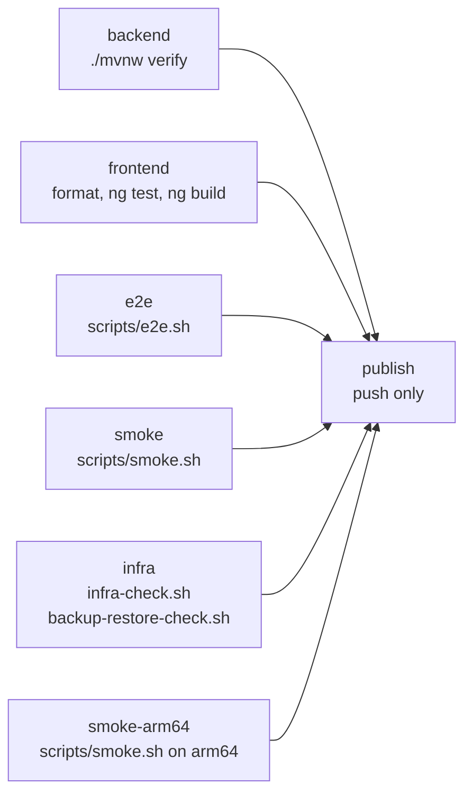

# Quality

How the project is tested and checked, what each script proves, and what the Plan 6 code audit found. Figures are counted from the repository on 2026-11-16 (commit `e68d468` plus this change); they will drift.

## Test pyramid

| Layer | Tool | Count | Where |
| --- | --- | --- | --- |
| Backend unit | JUnit 5 | 144 | 27 `*Test.java` files in `backend/src/test` |
| Backend integration | JUnit 5, Spring Boot, Testcontainers | 302 | 56 `*IT.java` files in `backend/src/test` |
| Frontend unit and component | vitest through `ng test` | 530 | 72 `*.spec.ts` files in `frontend/src` |
| Browser end to end | Playwright | 83 specs, run in two projects | 29 `*.spec.ts` files and one setup file in `e2e/tests` |

How these were counted, so the numbers can be reproduced:

- **Backend:** lines starting with `@Test` or `@ParameterizedTest` (`grep -rE "^\s*@(Test|ParameterizedTest)\b" backend/src/test`): 438 plus 8 = 446. A parameterized test is one declaration that runs several times, so the number of executed cases is higher.
- **Frontend:** lines starting with `it(` (522) plus lines starting with `it.each` (8) in `*.spec.ts`. Again, `it.each` runs more than once.
- **Playwright:** lines starting with `test(` in `e2e/tests` (83). 82 run in both the `mobile` and the `desktop` project, which is about 164 executions; the one in `restart.spec.ts` runs once. Three desktop-only gestures in `recipe-photos.spec.ts` skip themselves on mobile.

The backend and e2e counts are lower bounds on what runs: the audit that ran `mvn verify` on 2026-11-07 reported 320 backend tests and 421 frontend tests, so both suites have grown since.

### Integration tests

Integration tests extend `IntegrationTest`, which starts one shared `postgres:17-alpine` container with Testcontainers and boots the full Spring context against it. Flyway runs the real migrations, so the tests exercise the real schema, not an in-memory substitute. There is no mocked database anywhere in the backend suite. `BaselineMigrationIT` guards the migration history and the demo-mode tests extend `DemoIntegrationTest`.

### Browser tests

`scripts/e2e.sh` builds the Docker image, starts an isolated compose project (`ricettine-e2e`, with `e2e/compose.e2e.yaml` lifting the per-IP rate limits because all browsers share one gateway IP) and runs Playwright against it. Projects in `e2e/playwright.config.ts`:

- `setup`: creates the admin account and the saved login state the other projects reuse.
- `mobile`: Pixel 7 device profile, every spec except the restart one.
- `desktop`: Desktop Chrome at 1280x800, the same specs. Each feature has to pass at both sizes, which is the project rule for every PR.
- `restart`: runs once, after both device projects. It restarts the app container and checks that the session and an avatar survive, so it needs the compose project that `e2e.sh` sets up.

Traces and screenshots are kept on failure.

## Check scripts

Every script builds what it needs and cleans up after itself. Scripts that run `down -v` must set their own compose project name; `infra-check.sh` fails if one does not, so a check can never wipe a running local stack.

| Script | What it proves | CI |
| --- | --- | --- |
| `scripts/e2e.sh` | The built image works through a real browser at mobile and desktop sizes, and survives a restart. Also the memory gate (below). | `e2e` |
| `scripts/smoke.sh` | The image boots under compose, `/actuator/health` is UP, the SPA and its fallback route are served, the JVM runs with `MaxRAMPercentage=60`, and the memory gate passes. | `smoke`, `smoke-arm64` (native arm64 runner) |
| `scripts/infra-check.sh` | Workflows (actionlint), shell scripts (shellcheck), the Caddyfiles (`caddy validate`), `deploy/aws/mount-data.test.sh`, Terraform format, validate and 35 tests with mock providers (no AWS access), guards on the Terraform (no RDS, ELB, ECS, NAT gateway or VPC endpoint; `prevent_destroy` on the data volume; the certificate in us-east-1), and `scripts/docs-check.sh`. | `infra` |
| `scripts/docs-check.sh` | Every Mermaid block in `README.md` and `docs/*.md` renders with a pinned `mermaid-cli`, an unterminated block fails, and every relative link and image target exists. | `infra` (through `infra-check.sh`) |
| `scripts/backup-restore-check.sh` | A backup with `deploy/backup.sh`, a wipe of every volume, a restore with `deploy/restore.sh`, the data and avatar back, a failed restore leaves the database unchanged, and a demo backup covers the main database only. | `infra` |
| `scripts/https-smoke.sh` | Both Caddy overlays: self-host HTTPS (`compose.https.yaml`) and the AWS origin behind CloudFront (`compose.aws.yaml`). Needs ports 80 and 443. | manual |
| `scripts/multiarch-check.sh` | The image builds for amd64 and arm64 and both pass the smoke test (the foreign one under QEMU). | manual |
| `scripts/aws-verify.sh <domain>` | Read-only checks of a deployed AWS stack, with your credentials: health and security headers through CloudFront, HTTP redirect, the origin not reachable directly, unknown media is 404, both buckets block public access, the newest backup is under 26 hours old, private photos are not cached, and the demo host when `DEMO_DOMAIN` is set. | manual |
| `scripts/screenshots.sh` | Regenerates the images in `docs/images` from the demo stack. | manual |

`scripts/demo-content.sh` is a maintainer helper for the demo recipe fixture, not a check.

### Memory gate

`e2e.sh` and `smoke.sh` both end with the same gate: the app container must not have been restarted or OOM-killed during the run, which `docker inspect` and `docker events` answer. Without it an out-of-memory kill only shows up as unrelated connection failures in a browser test. The scripts also log the container's memory use and cgroup peak, and a best-effort JVM report. The reasoning behind the limits is in [architecture.md](architecture.md#memory-budget).

### Docs gate

`docs-check.sh` exists because diagrams and links rot silently. A diagram that does not render, or a link to a moved file, fails the `infra` job like a test would.

## Continuous integration

`.github/workflows/ci.yml` runs on every pull request and on pushes to `main` and `v*` tags. Six jobs run in parallel and independently. `publish` runs only on pushes, after all six pass, and pushes the multi-arch image (amd64 and arm64) to `ghcr.io/spezialissimo/ricettine`.

## Plan 6 code audit

After the first five plans the whole repository got a structured audit before more features were added. The full report is `docs/superpowers/audits/2026-11-07-code-audit.md`; the fixes were planned in `docs/superpowers/plans/2026-11-08-plan-6-audit-fixes.md`.

**Method.** Tool passes (jscpd for duplication, knip and depcheck for unused code, `mvn dependency:analyze`, `javac -Xlint:all`, an i18n key scan), then six area reviews. Each finding was checked against the code (`file:line`) and every High finding was re-read by hand. Audited commit `e4bcea9` on 2026-11-07.

**Findings: 102 in total, none Critical.**

| Area | High | Medium | Low | Total |
| --- | --- | --- | --- | --- |
| backend-security | 1 | 4 | 14 | 19 |
| backend-domain | 0 | 1 | 13 | 14 |
| backend-tests | 0 | 7 | 9 | 16 |
| frontend-app | 0 | 5 | 17 | 22 |
| frontend-tests-e2e | 0 | 5 | 5 | 10 |
| ops | 1 | 6 | 14 | 21 |
| **Total** | **2** | **28** | **72** | **102** |

**Decision (2026-11-08):** fix all High and Medium findings plus 21 cheap, reader-visible Low ones: 51 fixes, 51 left for later. The Low findings skipped were not hidden: they stay in the report marked "later".

**Outcome.** The 51 fixes shipped as nine small pull requests (A to I, merged as #27 to #35 after the report in #26), and each one closed its findings in the report. Counting the decision lines in the report today: 51 are marked `fix (PR <letter>)`, 51 `later`. The two High findings:

- A spoofed `X-Forwarded-For` or `Forwarded` header bypassed the per-IP rate limits (reproduced: 40 failed logins, no 429). Forwarded headers are now trusted only from configured proxies; see `RICETTINE_TRUSTED_PROXIES` in [deployment.md](deployment.md#configuration).
- `smoke.sh` ran `down -v` on the default compose project and could wipe a self-hosted stack started from the same folder. It now uses its own project name, and `infra-check.sh` enforces that for every script.

Other Medium fixes include a Content-Security-Policy and a fix for cacheable media carrying a CSRF cookie, S3 versioning and a stale-backup alarm on AWS, a bound on JVM memory, data-loss fixes in the editor conflict flow, pinning GitHub Actions to commit hashes, and running the infra checks and the backup drill in CI.

Fixing the audit also produced follow-ups that were deliberately not done, recorded in `docs/superpowers/plans/2026-11-08-plan-6-followups.md`; [security.md](security.md) lists the limits that remain.
