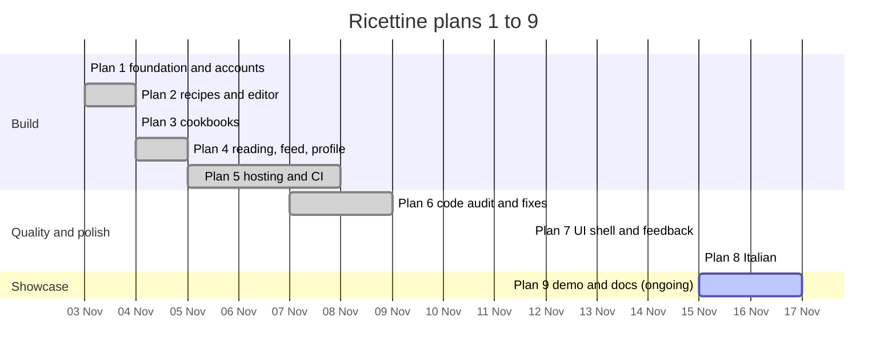

# Roadmap

What was built, in which order, and what is next. Dates are from `git log` on the plan files (start) and from the merged pull requests (merge), checked on 2026-11-16. The plans themselves are in [docs/superpowers/plans](superpowers/plans).

Plan 9 has no merge date yet: its first three pull requests (#48, #50, #51) had merged by 2026-11-16, and the plan ends with this documentation. The end of its bar is a placeholder. Plan 7's start is the date its plan file was first committed (2026-11-15); the file is named for 2026-11-12, when the feedback it records began.

## What each plan delivered

1. **Foundation and accounts** (merged 2026-11-03, #1): Spring Boot and Angular skeleton, setup of the first admin, invites, login, one Docker image with Postgres.
2. **Recipes and editor** (merged 2026-11-04, #2 to #9): recipe editor with autosave and publish, cover and step photos, reordering steps, share link and read-only recipe page, protection against losing typed text.
3. **Cookbooks** (merged 2026-11-04, #10 to #14): cookbooks, public cookbook page behind a share link, co-authors by invite link, account deletion that names what it removes.
4. **Reading, feed, profile** (merged 2026-11-05, #15 to #18): portion scaling with kitchen fractions, keep-screen-on, home feed of public recipes, profile page.
5. **Hosting and CI** (merged 2026-11-08, #19 to #25): rate limits, published multi-arch image, optional HTTPS with Caddy, backup and restore with a drill, AWS infrastructure as code.
6. **Code audit and fixes** (merged 2026-11-09, #26 to #35): a 102-finding audit, then 51 fixes in nine pull requests. See [quality.md](quality.md).
7. **UI shell and feedback** (merged 2026-11-15, #45): new app shell, My kitchen, settings, command palette, editor photos, reworked recipe and cookbook pages.
8. **Italian** (merged 2026-11-15, #46): Italian localization.
9. **Demo and docs** (ongoing): database routing per site (#48), a read-only demo with seeded Italian content (#50), a screenshot generator and docs images (#51), and this documentation (PR 4).

Between plans 8 and 9, #47 fixed the first real deploy to AWS (2026-11-15), and #49 repaired a smoke check that #48 had broken (see [ai-workflow.md](ai-workflow.md#what-went-wrong)). Dependabot bumps of GitHub Actions (#36 to #44) are not part of any plan.

## Next

- **Native Android client.** The project rules keep the APIs client-agnostic JSON with server-assigned ids so that a native client can be added later; there is no offline or PWA layer in the web app. Nothing is built yet.
- **Open follow-ups.** The latest follow-ups file is `docs/superpowers/plans/2026-11-08-plan-6-followups.md`. Plans 7 to 9 did not add one. Its headings:
  - PR A (security and ops quick wins)
  - PR B (response headers)
  - PR C (frontend bugs)
  - PR D (backend robustness)
  - PR E (AWS and CI)
  - PR G (frontend and e2e quality)
  - Deferred review minors (final whole-branch review), with sub-sections PR A to PR H

  The earlier files (`2026-11-03-plan-1-followups.md` to `2026-11-07-plan-5-followups.md`) keep items that no later plan picked up. The audit also left 51 Low findings marked `later` in [the audit report](superpowers/audits/2026-11-07-code-audit.md).
- **Owner-led UI polish.** The "Later" section of `docs/superpowers/plans/2026-11-12-plan-7-feedback.md` holds one item that is still open: a **cookbook collage cover**, where a cookbook without a cover shows a collage of its recipes' photos (a 2x2 grid for four or more, adapted layouts for fewer). It needs no new storage; the cookbook list endpoint would also return the first few entry thumbnails. The other bullets in that section (recipe photo framing, one address per content, a draft banner) are worded as already done. Visual polish is otherwise driven by the owner walking the app and giving feedback.
